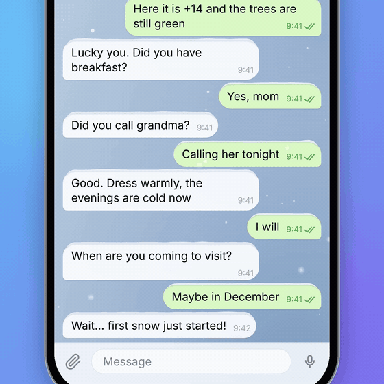
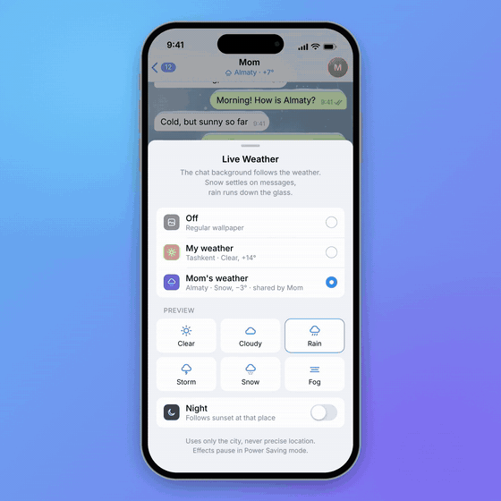

# Live Weather for Telegram

The chat wallpaper becomes the weather outside — yours, or the weather of the person you're writing to.

This repository holds a **working implementation** of the idea: a dependency-free weather engine, a Telegram-style chat that uses it, and a guide for wiring it into [Telegram Web A](https://github.com/Ajaxy/telegram-tt). Nothing in the demo video is animated by hand — every frame is rendered from this code.

<p align="center">
  
  &nbsp;
  
</p>

## How it feels

1. **Open the weather.** Under the contact's name there is a small line — `☁ Almaty · −3°`. Tap it to open the *Live Weather* sheet.
2. **Pick whose sky to see.** *Off*, *My weather*, or the other person's weather — available only if they chose to share their city.
3. **The chat turns into that place.** Snow falls behind the messages and slowly piles up on top of them, following their rounded corners. Rain runs down the "glass", thunderstorms flash, fog drifts, the sun throws soft rays and a sheen across the bubbles. After sunset there, the theme goes dark and the stars come out.
4. **It answers your touch.** Scroll, and the snow slides off the messages. Send a message in the rain, and the drops move aside to make room for it.

The main use case is emotional, not meteorological: you write to your mother in another city and see her first snow in your chat.

## Links

- 🎬 **Demo video** — [`demo/live-weather-presentation-silent.mp4`](demo/live-weather-presentation-silent.mp4) · with sound: [`demo/live-weather-presentation.mp4`](demo/live-weather-presentation.mp4)
- 🧪 **Try it** — open [`index.html`](index.html) in a browser (or the single file [`dist/live-weather.html`](dist/live-weather.html)), tap the weather under "Mom", or press **▶ Play demo**
- 📄 **Full write-up** — [`docs/WRITEUP.md`](docs/WRITEUP.md): how every effect works, data and privacy, performance, how the video was produced
- 🔌 **Integration guide** — [`docs/INTEGRATION.md`](docs/INTEGRATION.md): where it plugs into Telegram Web A and how it maps to iOS / Android
- 🗒 **Decision log** — [`docs/DECISIONS.md`](docs/DECISIONS.md): what was chosen, and why

## Status

- **Works:** all six weather states (clear, cloudy, rain, storm, snow, fog) × day/night, smooth crossfades, snow caps, raindrops that grow / slide / merge / part, splashes, lightning, the settings sheet, animated day/night theme, real weather from [Open-Meteo](https://open-meteo.com) when the page is opened locally.
- **Tested in:** desktop Chrome and headless Chrome (the video renderer). Not yet tested on low-end phones.
- **Prototype, not a patch:** the engine is a standalone module plus a demo chat. It is **not merged into an official Telegram client yet** — [`docs/INTEGRATION.md`](docs/INTEGRATION.md) describes the exact mount point (`Wallpaper.tsx`) and hook for Telegram Web A.
- **Needs a server change for production:** showing a *contact's* weather requires a new opt-in privacy setting and a field that carries only *condition + day/night + temperature* — never coordinates. Your own weather can reuse the backend behind the weather widget in Stories.

## Repository

```
index.html               demo page
src/weather-layer.js     the engine — palettes, particles, snow caps, drops, lightning (no dependencies)
src/weather-provider.js  current weather → one of 6 conditions (WMO codes, 30-min cache, city-level only)
src/app.js               Telegram-style chat, Live Weather sheet, scripted demo on a virtual clock
src/styles.css           iOS-style UI with an animated day/night theme
dist/live-weather.html   everything inlined into one file
docs/                    write-up, integration guide, decision log, media
tools/                   frame-exact video renderer, procedural sound design, presentation compositor
demo/                    presentation videos (1920×1920)
```

### Engine in 10 lines

```js
const layer = new TgWeather.WeatherLayer({
  background: bgCanvas,               // behind the messages
  foreground: fgCanvas,               // above the messages, pointer-events: none
  getBubbles: () => visibleBubbleRects(), // [{ el, x, y, w, h, r }] in layer pixels
  width, height, quality: 1,          // 0.3–1, scales particle counts
});
layer.setWeather('snow', /* night */ false);   // crossfades from the current state
layer.onMessageSent(rect);                      // raindrops make room
layer.onScroll(deltaY);                         // snow slides off
requestAnimationFrame(function loop(t) { layer.frame(t); requestAnimationFrame(loop); });
```

## License

MIT — see [LICENSE](LICENSE).

---

**Кратко по-русски.** Фон чата повторяет погоду — вашу или собеседника (только с его согласия). Снег оседает на сообщениях и осыпается при прокрутке, дождь стекает по «стеклу» и расступается вокруг нового сообщения, в грозу вспыхивает молния, после заката тема темнеет. Это рабочий прототип на чистом JS + инструкция по встраиванию в Telegram Web A.

**Qisqacha o'zbekcha.** Chat foni haqiqiy ob-havoni takrorlaydi — sizniki yoki suhbatdoshingizniki (faqat uning roziligi bilan). Qor xabarlar ustiga qo'nadi va aylantirganda to'kiladi, yomg'ir "oyna" bo'ylab oqadi va yangi xabar atrofida suriladi, momaqaldiroqda chaqmoq chaqadi, quyosh botgach tema qorong'ilashadi.
